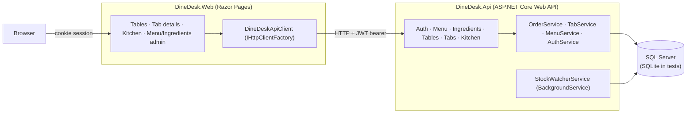

# DineDesk

[](https://github.com/edu-tech220/dinedesk/actions/workflows/ci.yml)


Restaurant order & kitchen management platform: servers open a tab per table,
send rounds to the kitchen, and the kitchen works them through a status
queue, while every order automatically consumes recipe ingredients from
inventory. Built as two ASP.NET Core 8 microservices — a Web API backend and
a Razor Pages frontend — sharing nothing but an HTTP contract.

## What it solves

A single restaurant shift needs several things to stay consistent at once:
who's seated where, what's been ordered, what the kitchen still owes the
table, whether the pantry can actually fulfill the next order, and how the
bill gets split at the end. DineDesk models all of that as one small
domain instead of a generic CRUD app:

- **Tabs**, not just orders — a table can run several rounds before anyone pays.
- **Recipes drive inventory** — placing an order decrements the exact
  ingredients it consumes, and running out silently removes the item from
  the menu instead of letting the kitchen find out the hard way.
- **The kitchen sees one queue**, not a wall of raw orders, and can only move
  an item forward one state at a time.
- **The bill is computed once, on the server** — tax, happy-hour discounts and
  split shares are never trusted from the client.

## Business rules

1. **Recipe-driven stock decrement.** Each menu item has a recipe (ingredient
   + quantity per serving). Placing an order aggregates the required quantity
   per ingredient across every line, decrements it in one optimistic-concurrency
   transaction (with automatic retry), and rejects the whole order — without
   touching any stock — if any ingredient would go negative.
2. **Auto-86.** Right after a successful decrement, any menu item that can no
   longer be fulfilled from current stock is flagged unavailable
   (`IsAvailable = false`). A background `StockWatcherService` sweeps every two
   minutes to re-enable items once a restock makes them fulfillable again.
3. **Kitchen state machine.** An order item can only move
   `Received → Preparing → Ready → Served`, one step at a time. Skipping a
   step, or acting on an item someone else just updated, is rejected.
   `Manager`/`Admin` can void an item instead (with a required reason), which
   restores the stock it would have consumed.
4. **Portable optimistic concurrency.** Ingredients, menu items, tabs and
   order items all carry a concurrency token. On SQL Server it's a native
   `rowversion`; on any other provider (SQLite in tests) it's a GUID stamped
   in a `SaveChanges` override — see [Technical decisions](#technical-decisions).
   Clients pass it back as an `If-Match` ETag header on writes that can race.
5. **Tab lifecycle & billing.** A tab opens only on a free table and closes
   only once recorded payments cover subtotal + tax + tip; closing frees the
   table back up. Split-evenly distributes rounding remainders in cents so
   nobody's share is a fraction of a cent off.
6. **Happy-hour pricing.** Eligible items get a time-windowed discount
   resolved server-side at order time from configured day/time windows —
   never trusted from the client, and the discounted price is captured on the
   order line so a later price change doesn't retroactively change an old bill.
7. **Role-gated writes.** `Server` opens tabs and places orders, `Kitchen`
   advances the queue, `Manager`/`Admin` manage the menu/inventory and void
   items. JWTs are PBKDF2-verified and rate limiting protects the API from
   abusive bursts.

## Architecture



## Technical decisions

- **Two independent ASP.NET Core projects, not a shared library.** The web
  app only knows the API's HTTP contract (its own DTOs in
  `DineDesk.Web/ApiClient/Models`) and never references `DineDesk.Api`
  directly — the same boundary a second, non-.NET client would have to work with.
- **Portable concurrency tokens.** `DineDeskDbContext` checks
  `Database.IsSqlServer()` in `OnModelCreating`: SQL Server gets a native
  `rowversion`; every other provider gets a plain `byte[]` concurrency column
  stamped with a fresh GUID in a `SaveChangesAsync` override. This is what
  lets the exact same business logic run against SQL Server in production and
  SQLite in tests.
- **`ChangeTracker.Clear()` between retry attempts.** Early versions of the
  stock-decrement retry loop only reloaded the specific entities EF reported
  as conflicting, which left other tracked entities from the failed attempt
  dirty — caught by the concurrency test as an intermittent, unhandled
  `DbUpdateConcurrencyException`. Clearing the tracker at the top of every
  attempt guarantees each retry re-reads current state from the database.
- **`ServiceResult<T>` instead of throwing for expected failures.** Services
  return a typed success/error outcome (`Validation` / `NotFound` / `Conflict`
  / `Forbidden`); a small base controller maps that to the matching HTTP
  status and an RFC 7807 `ProblemDetails` body.
- **ETag/`If-Match` for client-driven concurrency.** Endpoints that race
  (kitchen status updates, menu availability) return a base64 rowversion as
  an `ETag`-style string; the client must echo it back via `If-Match` to write.
- **SQLite integration tests via the real `Program.cs`.** `DineDeskApiFactory`
  swaps in a named shared-cache in-memory SQLite database before the host
  builds, so the exact same startup, DI and middleware pipeline that runs in
  production also runs in CI — no mocks, no separate test-only wiring.

## Endpoints

| Method | Route | Auth | Description |
| --- | --- | --- | --- |
| POST | `/api/auth/login` | Anonymous | Verify credentials (PBKDF2), issue a JWT |
| GET | `/api/menu` | Anonymous | Paginated menu, optional `category` filter |
| POST | `/api/menu` | Manager, Admin | Create a menu item with its ingredient recipe |
| PATCH | `/api/menu/{id}/availability` | Manager, Admin | Toggle availability (`If-Match` required) |
| GET | `/api/ingredients` | Any authenticated | List ingredient stock |
| POST | `/api/ingredients/{id}/restock` | Manager, Admin | Add stock to an ingredient |
| GET | `/api/tables` | Any authenticated | List dining tables and their status |
| GET | `/api/tables/{id}/open-tab` | Any authenticated | Look up the open tab on a table |
| POST | `/api/tables/{id}/open-tab` | Server, Manager, Admin | Open a tab (table must be free) |
| GET | `/api/tabs/{id}` | Any authenticated | Tab detail: rounds, items, status |
| GET | `/api/tabs/{id}/bill` | Any authenticated | Subtotal, tax, tip, total, balance due |
| POST | `/api/tabs/{id}/split-preview` | Any authenticated | Preview an even split across N guests |
| POST | `/api/tabs/{id}/orders` | Server, Manager, Admin | Place a round; decrements stock |
| POST | `/api/tabs/{id}/payments` | Server, Manager, Admin | Record a payment against the tab |
| POST | `/api/tabs/{id}/close` | Server, Manager, Admin | Close the tab once fully paid |
| GET | `/api/kitchen/queue` | Kitchen, Manager, Admin | Paginated active kitchen queue |
| PATCH | `/api/kitchen/items/{id}/status` | Kitchen, Manager, Admin | Advance one step (`If-Match` required) |
| POST | `/api/kitchen/items/{id}/void` | Manager, Admin | Void an item and restore its stock |

## Demo accounts

Seeded on first run (see `Data/Seed/DbSeeder.cs`):

| Username | Password | Role |
| --- | --- | --- |
| `admin` | `Admin#12345` | Admin |
| `manager` | `Manager#12345` | Manager |
| `server1` | `Server#12345` | Server |
| `kitchen1` | `Kitchen#12345` | Kitchen |

## Running it

### Option A — Docker Compose (API + Web + SQL Server)

```bash
docker compose up --build
```

- Web: http://localhost:8081
- API + Swagger: http://localhost:8080/swagger

### Option B — `dotnet run` (needs a local SQL Server)

Start just the database from the compose file, then run both projects:

```bash
docker compose up sqlserver -d

dotnet run --project src/DineDesk.Api    # http://localhost:5047/swagger
dotnet run --project src/DineDesk.Web    # http://localhost:5290
```

`src/DineDesk.Web/appsettings.json` already points `Api:BaseUrl` at the API's
`http` launch profile port, so no extra configuration is needed. The API
applies pending migrations and seeds demo data automatically on startup.

## Testing

```bash
dotnet test
```

The xUnit suite spins up the real ASP.NET Core pipeline (`WebApplicationFactory`)
against an isolated in-memory SQLite database per test class — no Docker or
SQL Server required. Coverage includes recipe-driven stock decrement, 10
concurrent orders racing for 4 remaining units of stock (never oversells),
the kitchen state machine with ETag concurrency, void-restores-stock, tab
billing/splitting, and role enforcement.

## Project layout

```
src/DineDesk.Api/     ASP.NET Core Web API — domain, EF Core, services, controllers
src/DineDesk.Web/     ASP.NET Core Razor Pages — calls the API via IHttpClientFactory
tests/DineDesk.Api.Tests/   xUnit + WebApplicationFactory integration tests
```
